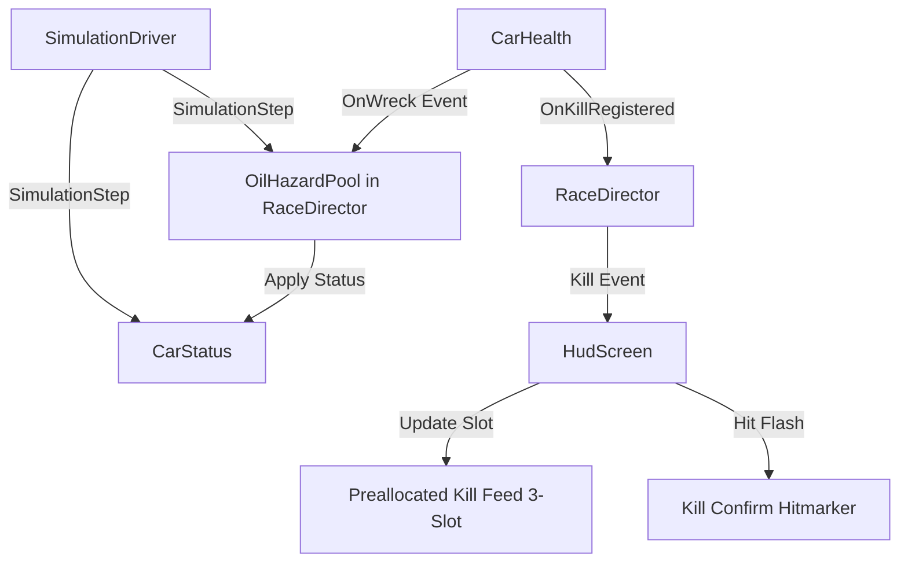

# Requirements

### Overview & Goals
The objective of this phase is to finalize the midcore MVP by completing the combat feedback loop, adding interactive track hazard gameplay, enhancing HUD visibility, and verifying the moderate economic progression (full arsenal unlocked within 15–25 races) for the WebGL release.

### Scope
#### In Scope
- **Kill Feed & Kill Confirmation**: Ring buffer kill feed (3 rows, 4s duration) and fatal hitmarker confirmation.
- **Oil Slick Hazards**: Triggerless simulation-level oil puddles spawned on car wrecks that inflict `Slowed` status and grip debuffs.
- **HUD Status Indicators**: Clear visual glyphs and icons for active status effects (`Frozen`, `Jammed`, `Punctured`, `Shield`).
- **Camera Shake Setting**: User toggle for camera impulse/shake in settings and persistence in `SettingsData`.
- **Progression & Economy Validation**: Automated economy simulation testing to ensure full arsenal unlocks in 15–25 races.
- **Allocation-free Runtime**: Zero GC allocations in the simulation and HUD hot paths.

#### Out of Scope
- Introducing completely new weapon classes (e.g. homing missiles or shurikens) until MVP polish is complete.
- Standalone Arena mode leaderboards and separate match loops (deferred to post-MVP).
- Custom 3D vehicle modeling pipeline integration.

### User Stories
- **As a player**, I want to see immediate feedback when I eliminate an opponent (red hitmarker and kill feed entry) so that combat feels satisfying and responsive.
- **As a player**, I want wrecks on the track to leave hazardous oil slicks so that navigating past destroyed rivals requires tactical steering.
- **As a player**, I want clear HUD indicators for active debuffs and shields so that I understand why my vehicle is sliding, slowed, or unable to fire.
- **As a mobile/web player**, I want consistent 60 FPS performance without GC stutter during intense battles.

### Functional Requirements
1. **Kill Feed**:
   - Displays up to 3 most recent eliminations in the format `[Killer] ✕ [Victim]`.
   - Each entry fades out after 4 seconds.
   - Updates dynamically without string formatting allocations during races.
2. **Hitmarker Kill Confirm**:
   - Hitmarker flashes distinctive red for 0.5s when the shot results in a wreck.
3. **Oil Slick Hazard**:
   - Spawns at wreck position upon vehicle destruction.
   - Max 3 active slicks simultaneously across the track.
   - Lifetime of 10 seconds.
   - Applies `Slowed` for 2s and grip factor 0.4 upon contact via `CarStatus`.
4. **Status Effect HUD**:
   - Shows active status effects using cached text/symbol representations.
   - Updates only when status bitmask or counts change.
5. **Camera Shake Setting**:
   - Toggle in Options menu persisting into player save data.

# Technical Design

### Current Implementation
- `CarHealth.cs`: Handles damage calculation, attribution of attacking vehicle IDs, and wreck events.
- `CarStatus.cs`: Simulates status effects (`Frozen`, `Jammed`, `Punctured`, `Shield`) in fixed ticks and applies dominant penalties.
- `HudScreen.cs`: Runtime-built UI containing speedometer, health bar, reticle, timer, and event toasts.
- `RaceDirector.cs`: Manages simulation objects, projectile pooling, and car registries.
- `Economy.cs` & `PlayerProgression.cs`: Defines rewards and weapon purchase tiers.

### Key Decisions
1. **Triggerless Oil Hazard Pool in `RaceDirector`**:
   - Avoids PhysX trigger callback overhead and dynamic allocations.
   - Checked inside `SimulationStep` using distance squared checks against active cars.
2. **Fixed Ring Buffer for Kill Feed in `HudScreen`**:
   - Pre-allocated TextMeshPro labels and pre-cached participant names from `strings.csv`.
   - No string concatenation or format calls in the per-frame update loop.
3. **Single Status Overlay Owner**:
   - Centralizes status icon state updates to prevent HUD layout recalculations.

### Architecture Diagram


### Components and File Structure
- `Assets/CarsGame/Game/Race/OilHazardPool.cs`: Manages active oil slick decals, timers, and distance collision checks.
- `Assets/CarsGame/Game/UI/HudScreen.cs`: Extends HUD with kill feed widget array, status icons, and kill confirm animation.
- `Assets/CarsGame/Game/Vehicle/CarHealth.cs` & `RaceDirector.cs`: Emits kill attribution events with killer ID and victim ID.
- `Assets/CarsGame/Core/Save/SaveData.cs` & `MenuScreens.cs`: Adds and persists `cameraShake` toggle.
- `Assets/CarsGame/Localization/Source/strings.csv`: Contains localized strings for AI names, status symbols, and settings.

### Data Models / Contracts
```csharp
public struct OilSlick
{
    public Vector3 Position;
    public int ExpireTick;
    public bool IsActive;
    public GameObject Visual;
}

public struct KillEvent
{
    public int KillerId;
    public int VictimId;
    public int ExpireTick;
}
```

# Testing

### Validation Approach
Verification will be performed via EditMode unit tests (via `./Tools/qa/edit-tests.sh`), simulation tests for economy balance, and PlayMode harness checks.

### Key Scenarios
1. **Kill Feed & Hitmarker**:
   - Target car reaches 0 HP from projectile -> `CarHealth` fires kill event.
   - Hitmarker transitions to red confirm color for 0.5s.
   - Kill feed pushes entry into ring buffer and displays localized names without GC allocation.
2. **Oil Slick Interaction**:
   - Destroyed vehicle triggers oil decal at crash position.
   - A passing car entering within 2.5m radius receives `StatusKind.Slowed` and grip penalty.
   - Slicks automatically expire and return to pool after 10 seconds or when cap of 3 is reached.
3. **Status Effect UI**:
   - Vehicle receiving `Frozen`, `Shield`, or `Jammed` immediately updates the corresponding HUD status slot.
4. **Camera Shake Setting**:
   - Disabling camera shake in settings prevents impulse from being applied to the main camera follow rig.

### Test Changes
- `Assets/CarsGame/Tests/EditMode/KillFeedTests.cs`: Tests for ring buffer indexing, slot decay, and formatting.
- `Assets/CarsGame/Tests/EditMode/OilHazardTests.cs`: Tests for pool capacity, expiry in ticks, and distance query triggers.
- `Assets/CarsGame/Tests/EditMode/EconomySimTests.cs`: Verification of average race coin payouts and weapon unlock rates.

# Delivery Steps

### ✓ Step 1: Implement Kill Feed and Hitmarker Kill Confirmation
The HUD displays kill confirmations on the hitmarker and a 3-slot kill feed without allocating GC memory during races.

- Preallocate a 3-entry ring buffer in `HudScreen.cs` for active kill events with duration timers (4 seconds).
- Subscribe `HudScreen` to `RaceDirector.OnKillRegistered` / `CarHealth` death notifications with killer and victim attribution.
- Implement kill confirmation visual feedback on `hitMarker` (0.5s distinct red cross transition on fatal shot).
- Pre-cache localized racer names from `strings.csv` (`ai.name.*`, `player.name`) to prevent runtime string formatting allocations.
- Add unit tests in `Assets/CarsGame/Tests/EditMode/KillFeedTests.cs` verifying slot rotation, duration decay, and allocation-free rendering.

### ✓ Step 2: Implement Triggerless Oil Slick Hazard System
Vehicle wrecks spawn temporary oil slicks on the track that apply slowed status and grip penalties via distance checks in simulation ticks.

- Create `OilSlickPool` in `Assets/CarsGame/Game/Race/` or inside `RaceDirector.cs` with a maximum capacity of 3 active slicks.
- Spawn flat ground decals (10-second lifetime) upon vehicle destruction events from `CarHealth.OnWreck`.
- Check vehicle distances against active oil slicks in `SimulationStep` without PhysX triggers or raycast overhead in the inner loop.
- Apply `StatusKind.Slowed` (2s) and reduced grip (0.4 factor) to vehicles stepping onto oil slicks via `CarStatus.ApplyStatus()`.
- Add unit tests in `Assets/CarsGame/Tests/EditMode/OilHazardTests.cs` validating spawn limits, lifetime expiry, and status application.

### * Step 3: Enhance HUD Status Icons and Camera Shake Settings
Players have clear status indicator widgets on the HUD and a configurable camera shake option in settings.

- Add dedicated icon/glyph widgets to `HudScreen.cs` for active statuses (`Frozen`, `Jammed`, `Punctured`, `Shield`) updating only on status change events.
- Integrate the camera shake toggle into `MenuScreens.cs` and serialize `cameraShake` in `SettingsData`.
- Bind the setting to `PlayerEffects.cs` / `CameraImpulse.cs` to enable/disable camera recoil and collision shake.
- Update `strings.csv` with localized labels for new HUD elements and settings options.
- Add EditMode tests verifying setting serialization and status HUD state transitions.

###   Step 4: Validate Economy Progression and WebGL Performance
The game's economy pace matches the target 15–25 race full-arsenal progression and runs within WebGL mobile memory and frame time budgets.

- Create automated simulation tests in `Assets/CarsGame/Tests/EditMode/EconomySimTests.cs` verifying that average player progression unlocks the full midcore arsenal within 15–25 races.
- Validate that all new features maintain 0 GC allocations per tick during active multi-car combat.
- Run test suite via `./Tools/qa/edit-tests.sh` to ensure all existing and new test suites pass cleanly.