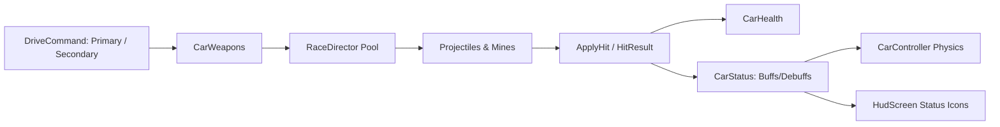

# Requirements

### Overview & Goals
Цель данного плана — реализация полноценного мидкор-слоя боевой гонки (в соответствии с утверждённым планом `Docs/AI/MidcoreDesign.md` v2). Новая система обогащает геймплей тактическими решениями: игроку и соперникам становятся доступны два слота вооружения (основное и вторичное оружие сброса назад), система статусных эффектов (`Frozen`, `Jammed`, `Punctured`, `Shield`), гибридное управление сбросом мин и расширенная мета-прокачка в гараже с сохранением высокой производительности WebGL (60 FPS на Mobile-тире).

### Scope
#### In Scope
- **Система статусов и урона**: Введение `HitInfo`/`HitResult`, единого обработчика попаданий в `CarHealth` и компонента `CarStatus` (заморозка, клин оружия, прокол шин, щит).
- **Арсенал вооружения**: Основной слот (пушка / скорострельный пулемёт), вторичный слот сброса назад (контактные мины с пулингом), снаряды заморозки и защитный щит.
- **Управление и тактика ИИ**: Расширение `DriveCommand` вторичным действием, гибридный автосброс мин при преследовании сзади, тактика очередей и объезда мин для `AiGunner`/`AiDriver`.
- **Интерфейс и HUD**: Отображение активных статусов на машине игрока, перегрева/боезапаса вторичного слота, хитмаркеры эффектов.
- **Гараж и Сохранения**: Покупка/экипировка модулей вооружения, миграция сейвов `SaveData` на версию v3 с объединением (union) владения.

#### Out of Scope
- Режим «Арена» и новые трамплины с каньонами (вынесены в последующую фазу контента).
- Дополнительные 3D-модели кузовов через сторонние генераторы (фокус на гей��плее текущего шасси).
- Изменение физического движка PhysX или переход на кастомный raycast-solver.

### User Stories
- **Как игрок на ПК или мобильном устройстве**, я хочу иметь возможность сбрасывать мины назад (как вручную кнопкой, так и с помощью интеллектуального автосброса при погоне), чтобы защищаться от наседающих соперников.
- **Как игрок**, я хочу видеть понятные эффекты статусов (замедление от заморозки, искры клина оружия, поглощение попадания щитом), чтобы оперативно реагировать на боевую обстановку.
- **Как игрок**, я хочу покупать в гараже пулемёты и мины за заработанные в гонках монеты и настраивать свой боевой сетап перед стартом заезда.

### Functional Requirements
- **FR-1 (Детерминированный урон и статусы)**: Все таймеры статусов и расчёты урона должны выполняться строго в тиках `ISimulated` (50 Гц) под управлением `SimulationDriver`.
- **FR-2 (Правило сильнейшего штрафа)**: При одновременном наложении нескольких замедляющих статусов штрафы не перемножаются, а выбирается максимальный действующий дебафф.
- **FR-3 (Лимиты пулов и безопасность памяти)**: Объекты снарядов и мин берутся из фиксированных пулов `RaceDirector` (`maxLiveProjectiles = 48`, `maxLiveMines = 24`) без динамических аллокаций в горячем цикле.
- **FR-4 (Гибридный автосброс)**: На сенсорных экранах вторичное оружие может автоматически срабатывать при нахождении противника в конусе преследования (дистанция 15–25 м, перекрытие по ширине), сохраняя ручную кнопку на экране.
- **FR-5 (Сохранения и миграция)**: Обновление схемы `SaveData` должно сохранять все накопленные игроком монеты, открытые трассы и уровни базовых улучшений.

### Non-Functional Requirements
- **Производительность WebGL**: Время кадра P95 ≤ 16.6 мс на PC и ≤ 33.3 мс на мобильных устройствах при 6 машинах в кадре и активной стрельбе.
- **Zero Allocations**: Нулевые аллокации GC в методах `SimulationStep` и `ApplyCommand`.
- **Локализация**: Все новые названия оружия, подсказки и статусы переводятся на 9 поддерживаемых языков через `strings.csv`.

# Technical Design

### Current Implementation
- `CarCannon.cs`: Управляет единственным орудием на крыше, спавнит снаряды через `RaceDirector.Instance.RequestProjectile`.
- `CarHealth.cs`: Ведёт счётчик HP, обрабатывает коллизии и респаун в тиках симуляции, но не имеет концепции щитов и модульных статусов.
- `CarController.cs`: Применяет `DriveCommand`, рассчитывает сцепление и тягу, опираясь на фиксированные характеристики шасси.
- `RaceDirector.cs`: Содержит пул снарядов `Projectile` с предпрогревом и потолком.
- `PlayerDriverInput.cs` & `TouchControlsPresenter.cs`: Транслируют ввод клавиатуры/тача в `DriveCommand` (поля Throttle, Steer, Brake, Fire, ResetEdge).

### Key Decisions
- **Модульная компонентная структура**: Разделение ответственности между `CarWeapons` (управление слотами и перегревом) и `CarStatus` (эффекты и модификаторы характеристик) для изоляции от физики `CarController` и жизней `CarHealth`.
- **Гибридный автосброс вторичного оружия**: Поддержка автоматического срабатывания мины при преследовании сзади на мобильных устройствах, дополненная явной экранной кнопкой и клавишей на ПК.
- **Доминирующий статус вместо перемножения**: Физика машины считывает единый максимальный модификатор скорости/сцепления из `CarStatus`, исключая блокировку управления до 0.
- **Пулинг мин и снарядов с жёсткими лимитами**: Мины спавнятся через `RaceDirector` с ограничением не более 6 мин на участок трассы 100 м и общим капом 24 мины на сцену.

### Proposed Changes
- **Модель данных и контактов**:
  - Ввести `HitInfo` (тип попадания, урон, вектор импульса, источник, статус) и `HitResult` (урон нанесён, поглощён щитом, фатален).
  - Ввести `StatusKind` (`None`, `Frozen`, `Jammed`, `Punctured`, `Shield`).
- **Компоненты транспорта**:
  - Создать `CarStatus.cs`: компонент `ISimulated`, обновляет активные таймеры статусов, вычисляет `SpeedMultiplier`, `GripMultiplier` и флаг `IsJammed`.
  - Создать `CarWeapons.cs`: компонент `ISimulated`, координирует основной слот (пушка / пулемёт) и вторичный слот (мины / заморозка), перегрев ствола и боезапас.
  - Создать префаб и логику `MineHazard.cs`: сброс позади машины с унаследованной скоростью, задержка взвода 0.5 с, таймер жизни 15 с.
  - Модифицировать `CarHealth.cs`: перевести вызовы урона на `ApplyHit`, проверять поглощение щитом (`CarStatus.ConsumeShield()`).
  - Модифицировать `CarController.cs`: интегрировать множители `CarStatus` в `ApplyMotor` и расчет бокового сцепления.
- **Ввод и управление**:
  - Добавить `DriveCommand.Secondary` и `DriveCommand.UseItem`.
  - В `PlayerDriverInput.cs` и `TouchControlsPresenter.cs` добавить обработку вторичной кнопки и логику гибридного триггера автосброса.
- **Тактика ИИ**:
  - `AiGunner.cs`: стрельба короткими очередями (3–5 снарядов) с разбросом и проверка статуса `Jammed`.
  - `AiDriver.cs`: обнаружение мин по ходу движения (Raycast/Overlap) и коррекция траектории смещением целевой полосы.
- **Экономика и Мета**:
  - Добавить структуры экипировки в `SaveData` (v3).
  - Обновить `Economy.cs` ценами на модули вооружения и `MenuScreens.cs` вкладкой экипировки в гараже.

### Architecture Diagram

### Components
- `RacingGame.Core.Combat`: Пакет структур данных (`HitInfo`, `HitResult`, `StatusKind`, `StatusEffect`).
- `RacingGame.Game.Vehicle.CarStatus`: Отслеживание активных эффектов, иммунитетов и расчёт физических модификаторов.
- `RacingGame.Game.Vehicle.CarWeapons`: Управление слотами оружия, нагревом, кулдаунами и запросами на спавн в `RaceDirector`.
- `RacingGame.Game.Pickups.ItemPickup`: Пикап со случайным бонусом (щит или мгновенный ремонт).

### File Structure
- `Assets/CarsGame/Core/Combat/` (новые файлы: `HitInfo.cs`, `HitResult.cs`, `StatusKind.cs`)
- `Assets/CarsGame/Core/Sim/DriveCommand.cs` (модификация: новые поля `Secondary`, `UseItem`)
- `Assets/CarsGame/Game/Vehicle/CarStatus.cs` (новый компонент)
- `Assets/CarsGame/Game/Vehicle/CarWeapons.cs` (новый компонент)
- `Assets/CarsGame/Game/Vehicle/MineHazard.cs` (новый компонент)
- `Assets/CarsGame/Game/Vehicle/CarHealth.cs` (модификация: метод `ApplyHit`)
- `Assets/CarsGame/Game/Vehicle/CarController.cs` (модификация: учет модификаторов `CarStatus`)
- `Assets/CarsGame/Game/Race/RaceDirector.cs` (модификация: пул мин)
- `Assets/CarsGame/Game/UI/HudScreen.cs` (модификация: иконки статусов и перегрева)
- `Assets/CarsGame/Core/Save/SaveData.cs` & `SaveMigrator.cs` (модификация: версия v3)

### Risks & Mitigations
- **Риск: Нагромождение мин на узких участках трассы**.
  *Митигация*: Жёсткий лимит не более 6 активных мин на 100-метровый отрезок трассы и максимальный кап 24 мины на гонку.
- **Риск: Потеря отзывчивости управления при статусе Frozen**.
  *Митигация*: `Frozen` срезает максимальную скорость и ускорение до 40%, но не отключает рулевое управление полностью; даётся иммунитет на 1.5 с после окончания эффекта.
- **Риск: Затирание прогресса игрока при обновлении сохранений**.
  *Митигация*: Автоматический парсинг старых версий в `SaveMigrator.Parse` с миграцией v1/v2 в v3 и сохранением всех покупок через `SaveMerge.Merge`.

# Testing

### Validation Approach
Тестирование проводится многоуровнево:
1. **NUnit EditMode-тесты**: Проверка математики статусов, переходов состояний, структуры команд `DriveCommand`, сериализации и миграции `SaveData`.
2. **Offline-компиляция и тесты без аллокаций**: Проверка отсутствия аллокаций в горячем пути (`GC.GetAllocatedBytesForCurrentThread`).
3. **PlayMode-тесты через RaceHarness**: Запуск тестовых заездов с ботами на 2 круга для проверки стабильности FPS, корректности работы пулов и отсутствия ошибок симуляции.

### Key Scenarios
- **Сценарий 1: Сброс и подрыв на мине**
  - Машина игрока сбрасывает мину назад;
  - Преследующий бот наезжает на мину после истечения времени взвода (0.5 с);
  - Бот получает импульс отдачи, 25 урона в центре взрыва и статус `Punctured` на 2.5 с;
  - Мина возвращается в пул `RaceDirector`.
- **Сценарий 2: Поглощение урона щитом**
  - Машина подбирает пикап `Item` и активирует статус `Shield`;
  - Прямое попадание вражеского снаряда или таран поглощается (`absorbed = true`);
  - HP машины не уменьшается, щит снимается, накладывается визуальный эффект вспышки щита.
- **Сценарий 3: Перегрев пулемёта**
  - Непрерывный огонь из пулемёта накапливает шкалу тепла (+2.5 за выстрел);
  - При достижении капа 100 оружие блокируется (статус перегрева) до остывания ниже 50%;
  - В HUD отображается индикатор перегрева.
- **Сценарий 4: Миграция старого сохранения**
  - Загрузка JSON-сейва версии v1/v2 без полей оружия;
  - `SaveMigrator` корректно восстанавливает дефолтный сетап вооружения без сброса баланса монет и купленных апгрейдов.

### Edge Cases
- **Сброс мины в барьер или другую машину**: Мина не должна взрываться мгновенно в момент спавна внутри собственного кузова (защитный период взвода 0.5 с).
- **Одновременное наложение нескольких дебаффов**: При активных `Frozen` (0.4 скорости) и `Punctured` (0.7 сцепления) применяется сильнейший штраф скорости, физика не уходит в отрицательные значения.
- **Исчерпание пула снарядов/мин**: При достижении капа метод запроса возвращает `false`, патроны не списываются, игра продолжает работу без падений.

### Test Changes
- Добавить `CarStatusTests.cs` (проверка таймеров статусов, приоритетов и иммунитетов).
- Добавить `CarWeaponsTests.cs` (проверка кулдаунов, боезапаса и логики перегрева).
- Добавить `MineHazardTests.cs` (проверка таймеров взвода, деспауна и радиуса поражения).
- Обновить `SaveMigratorTests.cs` тестами перехода с v1/v2 на v3.

# Delivery Steps

### ✓ Step 1: Базовый фундамент попаданий и система статусов
Базовая модель попаданий и статусных эффектов полностью функционирует в детерминированном тиковом цикле симуляции.

- Добавить структуры `HitInfo`, `HitResult`, `StatusKind` и `StatusEffect` в сборку `RacingGame.Core`.
- Реализовать компонент `CarStatus` (`ISimulated`), вычисляющий доминирующий штраф для физики машины (`CarController`) и отслеживающий статусы `Frozen`, `Jammed`, `Punctured`, `Shield`.
- Модифицировать `CarHealth.ApplyHit(in HitInfo)` для атомарного расчёта поглощения урона щитом, изменения HP, наложения статусов и отсечения непрямого урона.
- Написать модульные тесты в `CarStatusTests.cs` и `CarHealthHitTests.cs` для валидации тиковых таймеров и отсутствия аллокаций.

### ✓ Step 2: Слоты вооружения, пулемёт, мины и заморозка
Боевой арсенал расширен до двух активных слотов с поддержкой пулемёта, контактных мин, снарядов заморозки и защитного щита.

- Создать компонент `CarWeapons` (`ISimulated`), управляющий основным и вторичным слотами, кулдаунами, теплом/перегревом и боезапасом.
- Добавить префаб и поведение контактной мины `MineHazard` с ограниченным временем жизни (15 с), задержкой взвода (0.5 с) и пулингом в `RaceDirector`.
- Расширить `RaceDirector` пулом мин и снарядов с жёстким ограничением активных объектов (`maxLiveProjectiles = 48`, `maxLiveMines = 24`) и очисткой в `ResetRace()`.
- Реализовать снаряды заморозки (наследующие скорость стрелка и вызывающие статус `Frozen`) и пикап `Item` (дающий `Shield` или `Repair`).
- Добавить EditMode-тесты поведения пулов, взвода мин и перегрева оружия.

### ✓ Step 3: Ввод, гибридный автосброс, тактика ИИ и HUD
Игрок и боты полноценно используют основной и вторичный арсенал с гибридным автосбросом и обновлённым HUD.

- Расширить `DriveCommand` полями `Secondary` и `UseItem` в `RacingGame.Core.Sim`.
- Обновить `PlayerDriverInput` и `TouchControlsPresenter` с поддержкой гибридного автосброса мин при опасном сближении сзади и экранной кнопки.
- Модернизировать `AiGunner` и `AiDriver` для ведения огня очередями с учётом разброса и реактивного сброса мин при обнаружении хвоста на дистанции 15–25 м.
- Интегрировать индикацию активных статусов (`Frozen`, `Shield`, `Jammed`), перегрева и боезапаса вторичного слота в `HudScreen`.
- Проверить сценарии в PlayMode-харнессе `RaceHarness.cs` на стабильность FPS и отсутствие застреваний.

### ✓ Step 4: Гараж, экономика вооружения и миграция сохранений
Гараж позволяет разблокировать и экипировать оружие, а сохранения корректно мигрируют без потери прогресса.

- Расширить `SaveData` и `SaveMerge` поддержкой списка купленного оружия и выбранного слота экипировки (`SaveDataVersion = 3`).
- Обновить `SaveMigrator` с сохранением обратной совместимости для старых сейвов игроков.
- Добавить модуль каталога оружия в `Economy` и `PlayerProgression` с расчётом стоимости покупки и улучшений.
- Обновить интерфейс экрана гаража в `MenuScreens.cs` для выбора и предпросмотра экипированного арсенала.
- Добавить тесты миграции и слияния сейвов в `SaveServiceTests.cs`.