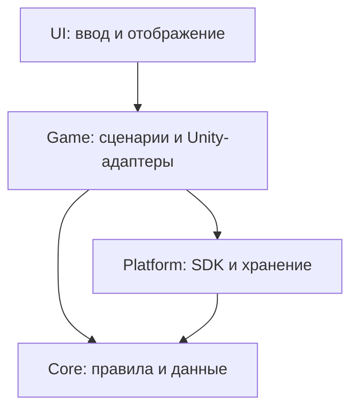

# План улучшения архитектуры и покрытия требованиями

Дата: 2026-09-25. Основа: HEAD `5a218a1` **и текущие незакоммиченные изменения**.
Статус: предложение по результатам статического обзора. Рефакторинг и новые тесты не выполнены.

## 1. Цель и исходное состояние

Сделать игровые правила проверяемыми отдельно от UI и сцены, сократить число причин изменения крупных классов, сохранить поведение существующих событий и подготовить ограниченный эксперимент с Unity ECS.

Подтверждено по репозиторию:

- Unity `6000.5.9f1`, URP `17.5.0`, Unity Test Framework `1.7.0`.
- Уже есть сборки `RacingGame.Core`, `RacingGame.Game`, `RacingGame.Platform`, Editor и две тестовые сборки. Их достаточно для первого этапа.
- Найдены 47 файлов `*Tests.cs` в EditMode и 7 в PlayMode. Это инвентаризация, а не процент покрытия или подтверждение успешного прогона.
- Уже выделены `Economy`, `RaceRanking`, `DriftCharge`, `KillTally`, `LapCounter`, `SaveMerge`; существуют контракты `IAds`, `ICloudSave`, `ICarInputSource`.
- `SimulationDriver` задаёт шаг 0.02 с и порядок вызовов; `RaceDirector` управляет пулами и RNG. Это полезная основа, но текущая реализация на MonoBehaviour не является Unity Entities ECS.
- Entities отсутствует в manifest/lock. Burst `1.8.30` и Collections `6.5.0` уже присутствуют как транзитивные зависимости; их наличие не означает использование DOTS игровым кодом.
- Web/Yandex — явно документированная цель (`Docs/Release/Yandex`, `Tools/qa/build-web.sh`). Параметры целевых устройств и браузеров для измерений ещё следует зафиксировать.

`UnityProjectContext.md` от 1 сентября устарел: описывает `Assets/Scripts`, отсутствие asmdef и тестов. Документы `MidcoreDesign.md`, `Arsenal.md`, `ArenaMode.md` относятся к разным этапам. Например, новый арсенал содержит 50 оружий, а новая арена с очками в дизайн-документе ещё отличается от текущего ранжирования по убийствам/смертям. Реализованное поведение и будущие требования нужно обозначать явно.

## 2. Приоритетные наблюдения

«Подтверждено» ниже относится к структуре исходников. Архитектурные риски не выдаются за воспроизведённые игровые ошибки.

| ID | Приоритет / серьёзность / уверенность | Свидетельство | Риск и действие | Объём / проверка |
|---|---|---|---|---|
| A1 | P0 / средняя / подтверждён старый результат, актуальность неизвестна | `test-results.xml`: 2026-09-24, 13 тестов, 9 passed, 4 failed | Перед переносами получить актуальную исходную точку и разобрать падения AI/прицеливания/ввода | Малый–средний; повтор упавшей группы, затем EditMode |
| A2 | P1 / средняя / подтверждена связанность | `Game/Flow/GameFlow.cs`, `OnFinished`, `RecordDaily`, `DoubleReward` | Расчёт награды, запись прогресса, рекорды, реклама, призраки и переходы сосредоточены в одном MonoBehaviour | Средний; сценарии финиша, DNF, повторной доставки результата и поздней рекламы |
| A3 | P1 / средняя / подтверждена связанность | `Game/UI/MenuScreens.cs`, `Buy`, `BuyWeapon`; `MenuScreens.Extras.cs`, покупка косметики | UI владеет частью операции покупки, списанием и сохранением; тест каталога не проверяет всю операцию | Малый–средний; изменение владения и баланса вместе, отсутствие изменений при отказе |
| A4 | P2 / средняя / подтверждена концентрация обязанностей | `Game/UI/HudScreen.cs`, 1364 строки | Создание разметки, подписки, оружейный круг, прицел, угрозы, статусы, kill feed, пауза и звук предупреждения связаны общим состоянием | Средний, по одному виджету; повторное включение, смена игрока/языка, размеры экрана |
| A5 | P2 / средняя / подтверждены неявные зависимости | `RaceSetup`, `PlatformGlue`, `SimulationDriver.Instance`, `Core/Combat/HitInfo.Attacker: GameObject` | Правила зависят от глобального состояния и Unity-объектов; сложнее изолировать тесты и переносить выбранную систему в ECS | Средний, только в затронутых операциях; тесты на обычных данных, отсутствие протекания состояния между гонками |
| A6 | P0 / средняя / подтверждено расхождение документов и реализации | `MidcoreDesign.md`, раздел о переполнении пула; `RaceDirector.RequestProjectile` и `RaceDirectorPoolTests` | Документ требует отказ выстрела без расхода патрона; код и тесты закрепляют переработку старого снаряда. Сначала определить действующий контракт | Малый; явное требование и один тест выбранной политики |

Четыре падения из сохранённого отчёта:

- `AiGunner_LaneChange_CommitsAimWithoutSidewaysLead`;
- `AiGunner_Telegraph_FreezesAimPointWhileWarningStays`;
- `CarCannon_CommitAim_HoldsBarrelWhileLiveTurretFollows`;
- `PlayerDriverInput_WheelAndScroll_UsePrimaryCommandAndCancelOnPause`.

Их причины в этом обзоре не устанавливались. Отчёт нельзя считать результатом всей текущей рабочей копии.

## 3. Границы разделения

Размер файла — ориентир для поиска, а не критерий приёмки. Извлечение считается полезным, когда новая часть владеет своими данными, имеет небольшой API и проверяется отдельно.

| Сейчас | Предлагаемая граница | Что остаётся у текущего владельца |
|---|---|---|
| `GameFlow.cs`, 598 строк | Сначала `RaceSettlement`: расчёт и применение результата к прогрессу; затем `GhostSessionController`: загрузка/запись призраков | Переходы Menu → Racing → Results, запуск и завершение Unity-сессии |
| `MenuScreens.cs` + `.Extras.cs`, 1002 строки | Сначала `GaragePurchases`: покупка, списание, экипировка и результат операции. После этого отдельные представления гаража и результатов, если их связи действительно отделены | Навигация, открытие экранов, toast и звук по результату операции |
| `HudScreen.cs`, 1364 строки | По очереди `WeaponWheelView`, `CombatHudView` (прицел, угрозы, обратная связь), `KillFeedView`; затем оценить оставшийся размер | Общий layout, видимость и привязка к текущему участнику |
| `CarController.cs`, 562 строки | Сначала визуализация колёс и старый аудиокод: проверить пересечение с существующим `EngineAudio`. При необходимости отдельно вынести расчёты движения | Один владелец Rigidbody и последовательности применения сил |
| `RaceManager.cs`, 383 строки | Условия окончания и формирование результата Race/Arena как небольшие функции над входными данными | Состав участников, countdown, события Unity. Существующий `RaceRanking` переиспользовать |
| `RaceDirector.cs`, 307 строк | Пулы отделять лишь при подготовке конкретного ECS-эксперимента или усложнении политики; использовать существующие `OilHazardPool` и `MineField` | Регистрация автомобилей и координация шага |

Новые имена обозначают обязанности, а не обязательный набор классов. Начальный перенос `RaceSettlement` может включать применение к `SaveData`; I/O остаётся у существующего `SaveService`. Достаточно явных аргументов и одного результата операции.

Для HUD подходят обычные классы с `Bind/Unbind/Refresh`, вызываемые экраном. MonoBehaviour нужен там, где действительно требуется самостоятельный Unity lifecycle. Простое разнесение одного класса по `partial` не уменьшит связанность.

Рекомендуемое направление зависимостей:

Новые правила расчёта наград и покупки не должны обращаться к `FindObjectByType`, `Time`, UI, Rigidbody или статическим сервисам. Время, результат гонки, настройки и состояние сохранения передаются явно. Существующие математические типы Unity в Core не требуют немедленной массовой замены.

## 4. SOLID, KISS и DRY в этом проекте

- **SRP:** разделять расчёт результата, сохранение, платформенный запрос и отображение. В одном изменении переносить одну обязанность.
- **OCP:** развивать существующий `PrimaryWeaponCatalog` и семейства `WeaponMode`; для нового набора чисел добавлять профиль. Новый обработчик нужен при новой механике. Пятьдесят подклассов оружия не нужны.
- **LSP:** одинаковые проверки контрактов для настоящих и поддельных платформенных адаптеров; одинаковая семантика `DriveCommand` для player/AI/scripted input.
- **ISP:** потребителю рекламы передавать существующий `IAds`, потребителю облачного сохранения — `ICloudSave`. Не передавать весь платформенный фасад без необходимости.
- **DIP:** бизнес-операции принимают данные и нужные контракты через параметры/конструктор. Unity-композиция остаётся в Game; контейнер DI пока не требуется.
- **KISS:** сохранить текущие сборки, NUnit и понятную последовательность тиков. Небольшой switch по двум режимам допустим; универсальный движок правил пока не нужен.
- **DRY:** переиспользовать `Economy`, `RaceRanking`, `RewardedOffers`, каталоги и `UiFactory`. В частности, свести две ветки показа rewarded (`DoubleReward` и `RewardedOffers.ShowAsync`) к общему выполнению после тестов на занятость, поколение гонки и выдачу награды. Сейчас `ShowAsync` проверяет `IsDoublingReward`: простая замена вызова заблокирует сама себя, владение флагом занятости нужно перенести согласованно.

## 5. Бизнес-требования и тесты

Вести короткие требования с ID и связью с именем теста. Помечать происхождение: «текущее поведение», «предлагаемый инвариант», «будущая функция». Ниже — начальная матрица; существующие тесты перечислены по исходникам, их прохождение не подтверждено.

| ID | Требование / критерий приёмки | Уже есть | Следующий необходимый тест |
|---|---|---|---|
| BR-ECON-01 | Первый завершённый заезд даёт минимум 150; DNF с нулём кругов даёт 0 и не расходует право на минимум | `EconomyTests` проверяет формулы | Последовательность DNF → первый финиш → следующий финиш через settlement и сохранение |
| BR-ECON-02 | Повторное убийство одной цели даёт убывающую награду; разные цели считаются независимо | `EconomyTests`, `KillTallyTests` | Пройти от счётчиков участников до фактического начисления; проверять по выбранной политике режима |
| BR-GAR-01 | Успешная покупка увеличивает уровень и списывает точную стоимость; недостаток денег/максимальный уровень не меняют данные | `EconomyTests`, `CosmeticsTests` | Полная операция покупки; границы `cost-1`, `cost`, max level, некорректный kind |
| BR-RESULT-01 | Предлагаемый инвариант: один результат сессии записывается один раз | Защита `RaceManager.EndRace` от повторного завершения | Два запроса завершения → одно событие и одно начисление. Без требований повторного применения после перезапуска достаточно защиты в пределах сессии |
| BR-ADS-01 | Удвоение только после успешной рекламы и максимум раз; ответ старой гонки не меняет новую | Guard по `raceGeneration` и `LastRewardDoubled` в `GameFlow` | Управляемый ответ fake `IAds`: success, cancel, error, двойной клик, выход в меню, старт новой гонки |
| BR-DAILY-01 | Бонус daily один раз за UTC-день, в том числе после merge двух устройств | `DailyChallengeTests`, `DailyCosmeticsSaveTests.TwoDevicesThatBothPaidTodaysBonusKeepOnePayment` | Два финиша + merge через путь записи; на границе UTC-дня начинается сегодняшнее событие |
| BR-PROG-01 | Открытия событий требуют завершения в топ-3; полученные звёзды сохраняются объединением битов | `StarGoalsTests`, `GameplayImprovementsTests`, тесты merge | Финиш/DNF → сохранение → доступность следующего события; смерть после финиша не меняет зафиксированную цель |
| BR-COMBAT-01 | Щит поглощает одно попадание; неуязвимость отклоняет попадание; по каждому параметру действует сильнейший штраф статуса | `CarHealthHitTests`, `CarStatusTests` | При изменении модели боя прогонять общий контракт для projectile/melee/beam/cone/pulse/trap, включая импульс |
| BR-WEAPON-01 | Смена оружия сохраняет его боезапас и перезарядку; перегрев и Jammed не обходятся сменой | `CarWeaponsTests`, `ArsenalExpansionTests` | Сценарий fire → switch → switch back на границе тика; параметризация по семействам вместо 50 копий |
| BR-SESSION-01 | Retry/Menu удаляет снаряды, мины и эффекты прошлой гонки; поздние async-ответы не возвращают их | `RaceDirectorPoolTests`, guards в `GameFlow`, PlayMode-сценарии | Race → Menu → Race, завершение отложенного ghost/ad запроса, повторный teardown |
| BR-LIFE-01 | OneLife исключает погибшего; rewarded continue доступен один раз за гонку | `TwistPlayTests.OneLifeKeepsWrecksOutAndContinueRevivesOnce` | Отказ/ошибка рекламы и смена сессии во время ожидания |
| BR-ARENA-01 | Текущее поведение: окончание по таймеру, порядок kills → deaths → CarId | `ArenaModeTests`, `RaceRankingTests` | Интеграция истечения времени с результатом и выплатой. Очки и «Угар» из `ArenaMode.md` оформить отдельными будущими требованиями |
| BR-POOL-01 | Текущее поведение: переполнение перерабатывает старый снаряд/сброшенную мину; мины поля исключены из лимита сброшенных | `RaceDirectorPoolTests`, `MineFieldAndChargeTests` | Согласовать с документом; проверить полный reset владельца, статуса, homing/ricochet при повторном использовании |

Пример формата теста: категория `[Category("BR-ADS-01")]`, имя `DoubleReward_OldSessionResponse_DoesNotCreditCurrentSession`. Категории добавлять по мере работы с соответствующими сценариями, без массового переименования набора.

Пирамида проверки:

1. **EditMode над обычными данными:** деньги, прогресс, награды, статусы, правила режима, границы тиков; поддельные время и рекламный ответ.
2. **EditMode с GameObject:** адаптеры, привязки, пулы, применение результата к Unity-компоненту. Существующие тесты такого типа сохранять.
3. **PlayMode:** запуск → countdown → финиш → результаты → retry, столкновения/респаун, pause/resume, one-life, очистка сессии.
4. **Целевой Web Player:** SDK, ввод, загрузка, память, кадры; успешный тест в Editor этого не заменяет.

После изменения: сначала тесты затронутого контракта, затем связанные интеграционные сценарии. Полный набор — перед объединением крупных переносов. Не добавлять тесты, которые только присваивают полю значение и читают его обратно. Процент line coverage пока не измерен; критерий первого этапа — проверенные бизнес-инварианты.

Существующий запуск: `Tools/qa/edit-tests.sh`. Он работает на копии, но `common.sh` при повторном запуске синхронизирует только Assets и один файл ProjectSettings, а также может копировать новые `.meta` обратно. Перед использованием как обязательного CI-порога обеспечить актуальность Packages/всех ProjectSettings и проверку результата XML. В этом обзоре скрипт не запускался.

## 6. DOTS / ECS: ограниченный эксперимент

Entities — реализация ECS в составе DOTS; Jobs/Burst можно оценивать отдельно от миграции всех объектов. Официальное описание: [Unity Entities 1.4](https://docs.unity3d.com/Packages/com.unity.entities@1.4/manual/index.html).

Для браузерной цели есть конкретное ограничение: [Entities Graphics 1.4](https://docs.unity3d.com/Packages/com.unity.entities.graphics@1.4/manual/requirements-and-compatibility.html) указывает отсутствие поддержки Web. Это ограничение рендеринга, а не доказательство запрета любой ECS-симуляции. Совместимость выбранного набора Entities/Burst/Unity 6000.5.9f1 проверять минимальной Web-сборкой до миграции игрового кода.

Первый кандидат — симуляция снарядов, если профиль подтвердит затраты именно здесь. Текущий лимит по умолчанию — 48 живых снарядов и 24 сброшенные мины; это само по себе не обосновывает полный перенос на ECS. Мины поля учитываются отдельно. Сохраняем Rigidbody-автомобили и GameObject-представление для первого эксперимента.

Возможная структура экспериментального среза:

- Данные: `ProjectileState` (позиция/скорость), `Lifetime` (тик истечения), `OwnerId`, параметры попадания.
- Системы: создание → движение → получение попаданий → применение → удаление.
- Unity-мост: синхронизация представления и физических запросов; существующий `HitInfo` с `GameObject` остаётся у моста, в ECS передаются ID.
- Единственный владелец позиции/времени жизни: выбранная система. Нельзя одновременно интегрировать один снаряд Rigidbody и ECS.
- На переходе сохранить политику переполнения, щит, неуязвимость, статус, владельца, наследование скорости и reset при reuse.

Измерение: одна сцена, seed, scripted input, сборка, устройство и браузер; прогрев и одинаковая длительность. Сравнивать CPU симуляции, P95 времени кадра, GC Alloc, память и размер сборки при обычной и целевой максимальной нагрузке. Бюджет P95 ≤ 33 мс из `MidcoreDesign.md` — прежняя цель Mobile-тиpa, её нужно привязать к конкретному устройству и текущему контенту. Выигрыш должен превышать разброс повторных измерений.

Условие принятия ECS-среза: проходят те же игровые контракты, работает целевая Web-сборка и есть измеримое улучшение целевой нагрузки без неприемлемого роста памяти/загрузки. При отсутствии выигрыша сохранить обычную реализацию. Полная миграция физики автомобилей требует отдельного обоснования и тестов управляемости.

## 7. Порядок небольших изменений

1. **Исходная точка и требования:** воспроизвести старые падения, получить текущий результат, зафиксировать активные правила арсенала/арены/пулов. Обновить контекст проекта. Готово, когда известны исходные ошибки и каждой затрагиваемой операции соответствует контракт.
2. **Гараж:** добавить проверки операции и выделить `GaragePurchases`, сохранив цены и экипировку. Готово, когда UI не меняет деньги/владение непосредственно, отказ не меняет прогресс.
3. **Завершение гонки:** закрепить settlement, daily и rewarded сценарии, затем извлечь их из `GameFlow`. Готово, когда нет повторной выплаты и влияния старого рекламного ответа на новую гонку.
4. **HUD и меню:** по одному виджету/экрану с переносом владения состоянием. Готово, когда сохраняются ввод, локализация, компактный layout и корректные подписки после повторного открытия.
5. **Границы симуляции:** сохранить одного владельца тика/физики; отделить представление автомобиля и правила режимов там, где есть самостоятельные контракты.
6. **ECS-spike:** проверить пакеты на Web, измерить исходную нагрузку, перенести один кандидат, сравнить. Включать в основную реализацию только по результатам проверки.

При переносах MonoBehaviour сохранять GUID существующих `.meta` и значения сериализованных полей. Переименование поля требует миграции сериализации; переименование/перемещение типа — проверки scene/prefab ссылок. Разделение логики не должно одновременно менять баланс, порядок тиков и формат сохранений.

## 8. Границы обзора

Проверены структура сборок, пакеты, крупные классы, цепочки покупки/завершения/рекламы, симуляция и пулы, исходники выбранных тестов, QA-скрипты и дизайн-документы. Это сфокусированный архитектурный обзор, не полный аудит проекта.

Не выполнялись новые тестовые прогоны, компиляция, Play Mode, сборка, profiler capture, проверка сцены и prefab-ссылок в Editor. Runtime-производительность, покрытие строк и совместимость предлагаемого ECS-среза пока неизвестны. Изменён только этот документ.
